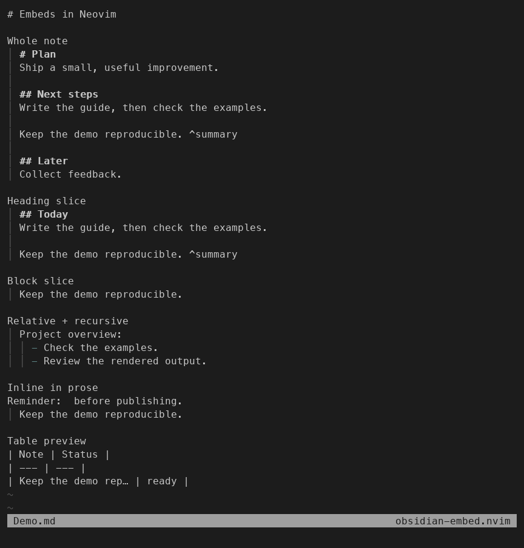

# obsidian-embed.nvim

Render Obsidian note embeds inline in Neovim.

Preview a whole note, a heading section, or a block without leaving the note
you are editing. Embeds are display-only: the plugin does not expand or change
the Markdown saved to disk.



Captured from the plugin in Neovim; see the [capture notes](doc/demo/README.md).
For the in-editor guide, use `:help obsidian-embed`.

## Requirements

- Neovim 0.11 or newer
- [obsidian.nvim](https://github.com/obsidian-nvim/obsidian.nvim) v3.16.8 or newer
- Markdown and Markdown Inline Tree-sitter parsers
- [obsidian.nvim's dependencies](https://github.com/obsidian-nvim/obsidian.nvim#installation),
  including `ripgrep` for workspace note lookup

## Installation

With [lazy.nvim](https://github.com/folke/lazy.nvim):

```lua
-- Add these entries to your lazy.nvim plugin list.
{
  "obsidian-nvim/obsidian.nvim",
  ft = { "markdown", "obsidian_base" },
  dependencies = { "nvim-lua/plenary.nvim" },
  opts = {
    legacy_commands = false,
    workspaces = {
      { name = "notes", path = "~/notes" }, -- your existing vault
    },
  },
},
{
  "tommoa/obsidian-embed.nvim",
  ft = { "markdown", "obsidian_base" },
  dependencies = { "obsidian-nvim/obsidian.nvim" },
  opts = {},
  config = function(_, opts)
    require("obsidian-embed").setup(opts)
  end,
}
```

Configure `obsidian.nvim` separately with a workspace. The dependency loads
its configured lazy.nvim spec before this plugin calls `setup()`.
If you already have an Obsidian spec, keep it and add the embed spec. With other
plugin managers, call `require("obsidian").setup(...)` before
`require("obsidian-embed").setup({})`.

### Install the Markdown parsers

The plugin needs both `markdown` and `markdown_inline`, with compatible
Tree-sitter queries on Neovim's runtime path. Installing this plugin does not
install the parsers. Your distribution may already supply them.

For **Neovim 0.12+**, use current
[nvim-treesitter `main`](https://github.com/nvim-treesitter/nvim-treesitter/blob/main/README.md):

```lua
-- A separate lazy.nvim entry; nvim-treesitter should not be lazy-loaded.
{
  "nvim-treesitter/nvim-treesitter",
  branch = "main",
  lazy = false,
  build = ":TSUpdate",
}
```

Then install once in Neovim:

```vim
:lua require("nvim-treesitter").install({ "markdown", "markdown_inline" })
```

Installation is asynchronous; wait for it to finish before refreshing embeds.
For bootstrap scripts, append `:wait(300000)` to that Lua call. Follow upstream's
requirements for a C compiler, `tar`, `curl`, and `tree-sitter-cli` (currently
0.26.1+ on `main`). The old `nvim-treesitter.configs` setup API is not used on
`main`.

For **Neovim 0.11**, use the frozen
[`master` branch](https://github.com/nvim-treesitter/nvim-treesitter/blob/master/README.md)
in that spec (`branch = "master"`), then run:

```vim
:TSInstall markdown markdown_inline
```

Follow that branch's compiler/CLI requirements. Update matching parsers and
queries together with `:TSUpdate`, then run `:Obsidian embed refresh`.

## Usage

Open a Markdown note inside your configured workspace. The plugin attaches to
buffers marked by `obsidian.nvim` and exposes:

- `:Obsidian embed toggle`
- `:Obsidian embed refresh`
- `:Obsidian embed inspect`

Lua users can call `require("obsidian-embed").toggle()`, `refresh()`,
`inspect()`, and `register_provider()` directly.

### Embed examples

Given `Plan.md` in your vault:

```markdown
# Plan
Ship a small, useful improvement.

## Next steps
Write the guide, then check the examples.

Keep the demo reproducible. ^summary

## Later
Collect feedback.
```

Use these in another note:

| Syntax | Preview |
| --- | --- |
| `![[Plan]]` | The whole note, excluding YAML frontmatter by default. |
| `![[Plan#Next steps]]` | The heading and its section, ending before `## Later`. |
| `![[Plan#Next steps\|Today]]` | The same section with its first heading displayed as `## Today`. |
| `![[Plan#^summary]]` | `Keep the demo reproducible.` with the block ID removed. |
| `![[./Plan]]` | `Plan.md` beside the note containing this reference. |
| `![[../Shared/Checklist]]` | `Checklist.md` in the parent directory's `Shared` folder. |

The backslash before `|` in the table is Markdown table escaping; in a note,
write `![[Plan#Next steps|Today]]`. An alias replaces only a leading heading;
it does not rename plain text or modify the target file.

An empty target selects the current note: `![[#Next steps]]` or
`![[#^summary]]`. Place these outside the section/block they select to avoid a
recursive cycle. Markdown-style embeds also work, such as ``
and ``. Use normalized heading fragments
(`next-steps`) in Markdown-style links; percent-encoded heading fragments are
not decoded by the current resolver.

**Recursive and relative embeds:** if `Projects/Overview.md` contains
`![[../Shared/Checklist]]`, embedding `![[Projects/Overview]]` expands that
child relative to `Projects/Overview.md`. Nested references do not resolve
relative to the outer note. Expansion stops beyond eight note levels or when
the same file and heading/block selection reappears in the current expansion
chain. Both cases show `Embed skipped: recursion limit reached`; these limits
are fixed, not setup options.

**Inline embeds:** `Reminder: ![[Plan#^summary]] before publishing.` keeps the
surrounding prose on its source row and displays the block below it. Multiple
embeds on a row render below it in source order. Standalone embeds replace
their source row's display when hidden. Lists, tasks, and blockquotes retain
their host indentation/markers, for example:

```markdown
- ![[Plan#^summary]]
- [ ] ![[Plan#Next steps]]
> ![[Plan#^summary]]
```

**Tables:** a pipe-table embed shows the first nonblank rendered line, fitted
to the display width of its original token. It can include the rail or a
warning. Longer previews end in `…`; preview pipes become `¦`, keeping later
cells in place. Tables do not expand into multiple virtual lines.

```markdown
| Note | Status |
| --- | --- |
| ![[Plan#^summary]] | ready |
```

With the default `source = "reveal_cursor"`, the raw token returns on the
cursor row. With `source = "show"`, tables keep their raw tokens.

### Target lookup and exclusions

For predictable lookup, use explicit `./` or `../` paths, including `.md` if
desired. Other targets try paths beside the host note, at the workspace root,
and in configured notes/daily-note folders before workspace search by reference
IDs (including aliases). If several notes match, the plugin shows
`Multiple matches for: ...` and renders the first candidate. Use a more precise
path rather than depending on candidate order. Missing notes, headings, and
blocks produce an inline warning.

URI targets (including `https:` and `file:`) and attachment suffixes recognized
by obsidian.nvim (such as images, PDF, audio, video, and `.canvas`) remain
literal. They are excluded **before custom provider matching**, including in
nested embeds. Ordinary links and footnotes are not note embeds. Embed-like
text inside code spans, fenced/indented code blocks, HTML blocks/comments, and
YAML frontmatter also remains literal.

### Custom embed providers

Providers are tried in registration order before the built-in Markdown note
renderer. URI and attachment embeds are skipped before provider matching.
This example renders the first line of `![[status.txt]]` from the active
workspace:

```lua
local unregister = require("obsidian-embed").register_provider({
  name = "status-file",
  match = function(ref) return ref.target == "status.txt" end,
  render_async = function(ref, ctx, done)
    local path = vim.fs.joinpath(ctx.workspace_root, ref.target)
    local cancelled = false
    vim.schedule(function()
      if cancelled then return end
      local lines = vim.fn.getbufline(path, 1)
      if #lines == 0 then
        local ok, disk_lines = pcall(vim.fn.readfile, path)
        if not ok then done(nil, tostring(disk_lines)); return end
        lines = disk_lines
      end
      local first_line = lines[1] or ""
      done({
        dependencies = { path },
        project = function(_width)
          return { { { first_line, "Normal" } } }
        end,
      })
    end)
    return function() cancelled = true end
  end,
})

-- Call unregister() when removing or reloading this provider.
```

`match(ref, ctx)` runs in registration order; the first matching provider owns
the embed. `ref.target` is the target from the embed syntax. The context has
`bufnr`, `workspace_root`, `host_path`, `base_dir`, `ref`, and `generation`.
`host_path` and `base_dir` can be absent when not applicable.
`render_async(ref, ctx, done)` must call `done(result)` or `done(nil, error)`.
A successful result needs `project(width)`, which returns virtual lines: each
line is a list of chunks shaped like `{ "text", "highlight_group" }`.
`width` is the projection width in display cells; providers can use it when
needed. Top-level results can be projected again after a window resize.
Optional `dependencies` are filesystem
paths whose loaded-buffer edits, writes, and `FileChangedShellPost` events trigger
refreshes; there is no continuous filesystem watcher. Return a cancellation
function for pending work; callbacks from a cancelled render are ignored. The
returned `unregister()` function removes the provider and can be called more
than once. Unregistering does not cancel renders already in flight. The
scheduled file read above is suited to small files; use nonblocking I/O for
larger work. See `:help obsidian-embed-providers` for the full contract.

## Configuration

```lua
require("obsidian-embed").setup({
  presentation = {
    source = "reveal_cursor",
    frontmatter = false,
    rail = "│ ",
    highlights = {
      text = "ObsidianEmbedText",
      rail = "ObsidianEmbedRail",
      warning = "ObsidianEmbedWarning",
    },
    nowrap_overflow = "trunc",
  },
})
```

`source` accepts `"reveal_cursor"`, `"conceal"`, or `"show"`.

- `reveal_cursor` (default): show the token on the cursor row in each window.
- `conceal`: request hiding the token on every row.
- `show`: keep source tokens alongside previews; tables keep only the tokens.

Neovim's window options still control concealment. For hidden tokens, set
`conceallevel=2`; `concealcursor` controls whether concealment applies in the
current mode on the cursor line. For example, in a Markdown `FileType` callback:

```lua
vim.opt_local.conceallevel = 2
-- Useful with source = "conceal" to hide tokens on the cursor line in Normal mode:
vim.opt_local.concealcursor = "n"
```

The plugin does not set these options for you. Rendered lines follow each
window's `wrap` and `linebreak` settings; with `nowrap`, overflow is truncated.
The configuration above lists all public options: recursion and scheduling
limits are not user settings.

## Troubleshooting

| Symptom | Check / action |
| --- | --- |
| Setup error or missing `:Obsidian embed` | Configure obsidian.nvim v3.16.8+ before embed setup; use Neovim 0.11+. The examples use `legacy_commands = false`. |
| No previews in a note | Open a named note inside a configured workspace. Check `:lua print(vim.b.obsidian_buffer)` is `true`, then re-enter the buffer after setup. A `.obsidian` folder alone does not configure a workspace. |
| Parser warning / degraded state | Run `:checkhealth vim.treesitter` (and `:checkhealth nvim-treesitter` if installed); install both parsers and update compatible queries. Then refresh. |
| Table preview shifts neighboring cells | Another highlighter may be concealing parts of the source token. Try `:lua vim.treesitter.stop()` and `:syntax off` to isolate the preview; disable the overlapping conceal rules in your configuration. |
| Raw tokens still visible | Check `:setlocal conceallevel? concealcursor?` and `presentation.source`. Cursor-row reveal is the default. |
| Missing or unexpected target | Check the file/heading/block spelling and workspace. Use an explicit relative path to avoid ambiguous matches; ensure `rg` is available for workspace search. |
| Preview seems stale | Run `:Obsidian embed refresh`; use `:Obsidian embed inspect` for lifecycle state and diagnostics. Refresh preserves a buffer's disabled state; toggle it back on if needed. |

Edits to the source and loaded dependency buffers (including unsaved target
edits) refresh automatically. Writes, observed note creation/renames, and
`FileChangedShellPost` also invalidate affected previews. There is **no continuous
filesystem watcher**. For a target changed outside Neovim, use `:checktime` to
let Neovim detect/reload a loaded file, or explicitly refresh the host note.
Resolution prefers loaded buffer contents, so a modified target buffer can
continue to override its on-disk file until you resolve/reload it. A file
created externally with no observed event requires an explicit refresh.

## License and releases

This checkout has no declared license or release tags. The author's license
and first-release decisions are pending; see the concrete
[decision note](doc/licensing-release.md). No license is implied by the
dependency licenses.

## Development

Run the Nix smoke checks with `nix flake check`. Nix and CI use the same
`scripts/test.sh` runner, which discovers `tests/*-smoke.lua`, checks the
architecture boundaries, and runs each test in a separate headless Neovim
process with `-u NONE -i NONE` and temporary HOME/XDG directories.

To prepare the same dependencies without Nix on Linux or macOS (x86_64 or
arm64), install Python 3.9+, curl, tar, and ripgrep, then run:

```sh
python3 scripts/prepare-tests.py /tmp/obsidian-embed-deps \
  --neovim v0.11.0 --obsidian minimum
. /tmp/obsidian-embed-deps/env.sh
./scripts/test.sh
```

The destination must be a new directory; existing directories are never
overwritten. If preparation fails or you interrupt it with Ctrl-C, the
preparer removes its partial destination so you can retry the same command.
Use `--neovim stable` and `--obsidian stable` to test the latest
non-prerelease GitHub releases, or
specify a Neovim release tag and an Obsidian commit/tag to reproduce a run.
The preparer verifies the Neovim archive checksum and records resolved tags,
source commits, and archive hashes in `versions.json`. Plenary is pinned to
the same revision as Nix. Both Markdown parsers and their highlight queries
come bundled with the selected Neovim release and are covered by its archive
checksum; no parser compilation is required.

With existing dependencies, set `OBSIDIAN_EMBEDS_RTP` to absolute,
colon-separated paths to obsidian.nvim, plenary.nvim, and a runtime containing
both parsers, then run `./scripts/test.sh`. Set `NVIM_BIN` to choose an executable.
The runner checks parser/query availability before running the suite and
does not fall back to plugins from your personal configuration.

CI runs all four combinations of Neovim v0.11.0/latest stable and
obsidian.nvim v3.16.8/latest stable on Ubuntu, on pushes, pull requests,
manual dispatch, and weekly. As of 2026-10-13 the stable versions are Neovim
v0.12.6 and obsidian.nvim v3.16.8, so the two Obsidian lanes currently resolve
to the same commit. Stable lanes follow new releases automatically; the
weekly run can expose upstream API changes without a repository commit.
Failures block their matrix cell, other cells continue, and the job summary
records exact versions for reproduction. Nix retains its locked dependencies
and checks on all systems declared in `flake.nix`.
